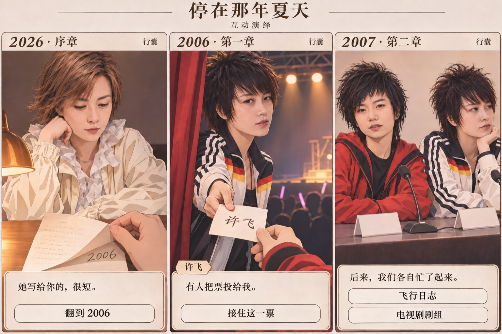
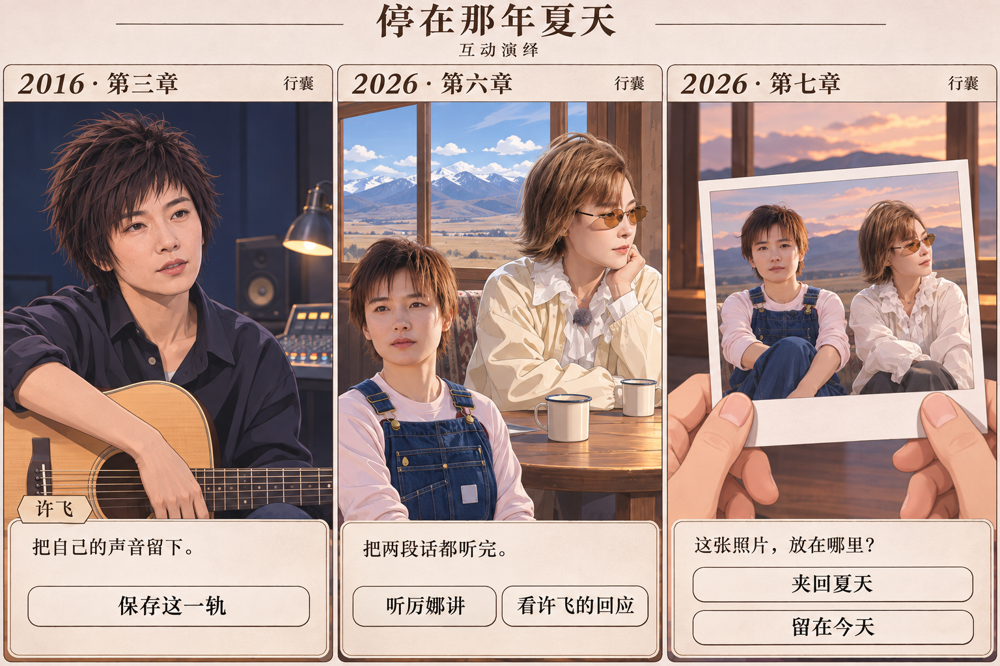
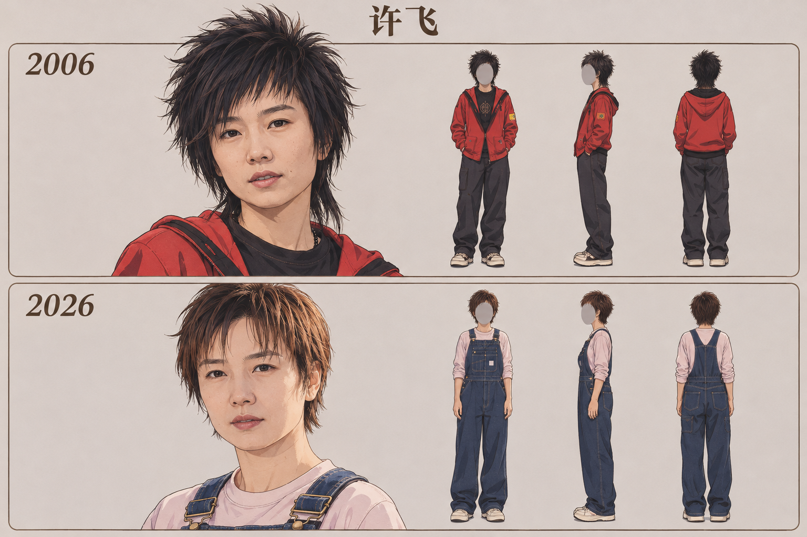
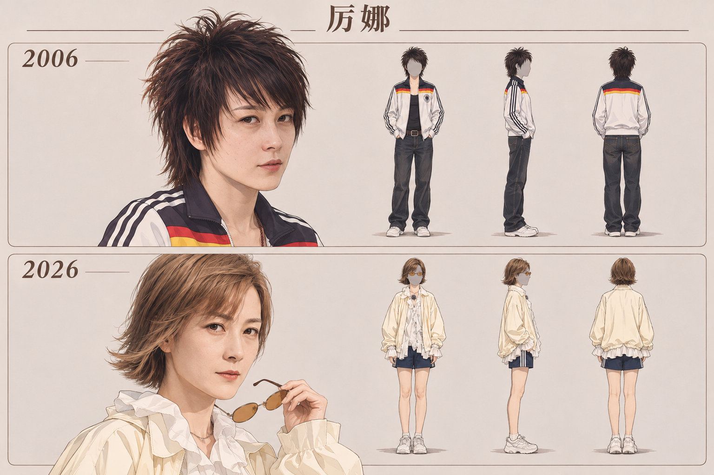

# 停在那年夏天

以许飞与厉娜的公开经历为线索的手机文字冒险游戏。此仓库收录开发前审阅稿。图中人物、对白和场景均为游戏演绎。

[阅读完整剧本与产品需求](剧本与产品需求.md)

## 六屏界面

**翻信 · 接票 · 采访**

**录音 · 对谈 · 尾声**

## 双年代人物设定

**许飞**

**厉娜**

人物设定对照 2006 年采访照和 2026 年节目组照片。2016 年录音室的发型与服装、2007 年采访造型和尾声相片属于游戏美术演绎。 [2006 年许飞](https://ent.sina.com.cn/y/p/2006-09-25/12361262412.html) · [2006 年厉娜](https://ent.sina.com.cn/y/p/2006-09-25/12361262414.html) · [2026 年节目组照片](https://news.sina.com.cn/zx/2026-10-22/doc-iniwavxi5136947.shtml)
